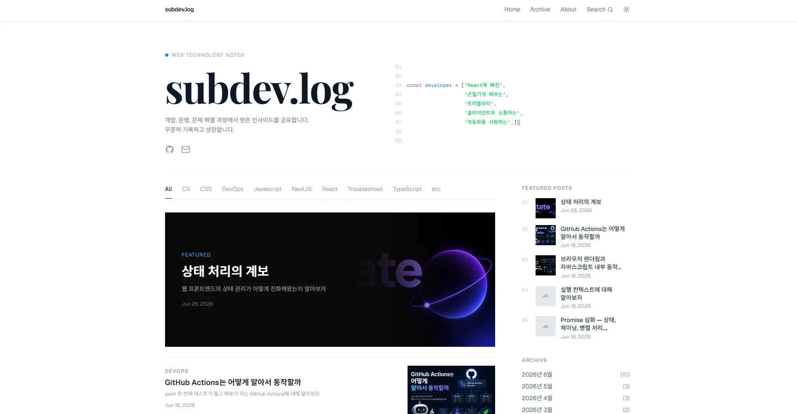
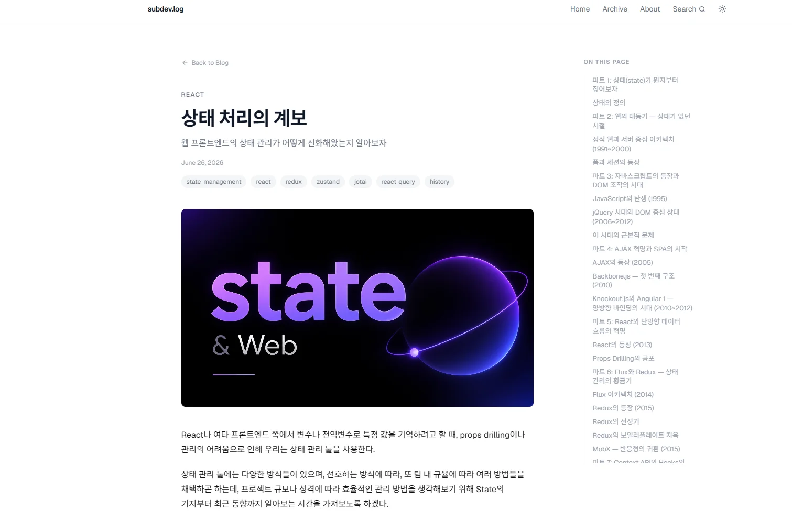
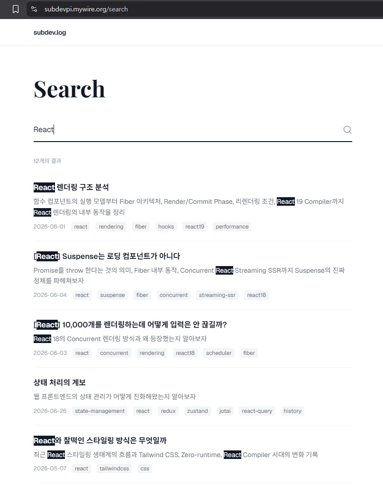
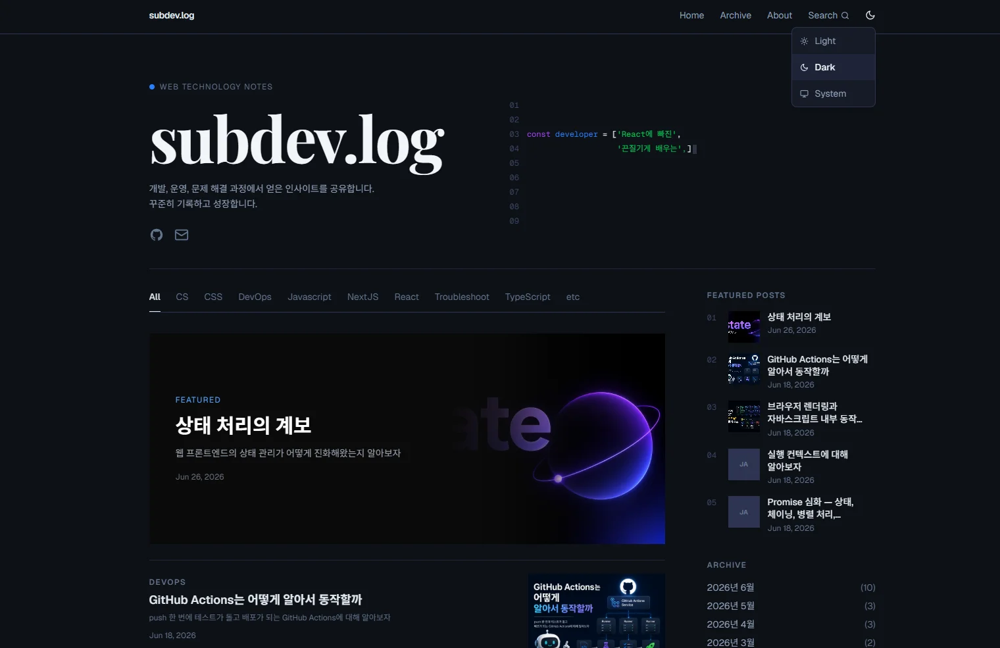

# subdev.log

> 개발하며 공부한 내용, 프로젝트 기록, 주간 프론트엔드 소식(FE News)을 올리는 개인 기술 블로그



## 1. 개요

| 항목 | 내용 |
|---|---|
| 운영 시작 | 2026.06 |
| 운영 방식 | 라즈베리파이 홈서버에 Docker로 직접 배포 |
| 참여 | 개인 프로젝트 |
| 기술 | Next.js 16, React 19, TypeScript, Tailwind CSS 4, Markdown(gray-matter, react-markdown), Shiki, Fuse.js, Docker, Nginx, GitHub Actions |
| 링크 | [subdevpi.mywire.org](https://subdevpi.mywire.org), [포트폴리오](https://subdevpi.mywire.org/portfolio) |

## 2. 화면

| 글 상세 | 검색 |
|---|---|
|  |  |
| 목차, 코드 하이라이팅 | 빌드할 때 만든 인덱스로 브라우저에서 검색 |

| 다크 모드 |
|---|
|  |
| 시스템 설정을 따르거나 직접 전환 |

## 3. 주요 기능

- 글: Markdown 파일로 작성, 카테고리 필터, 목차, 코드 하이라이팅, 연도와 월별 아카이브
- 검색: 빌드할 때 검색 인덱스(`public/search-index.json`)를 만들고 Fuse.js로 검색
- 포트폴리오: 프로젝트 소개 페이지. 목록에서 누르면 모달로, 주소로 바로 들어오면 전체 페이지로 열리고, 일부 프로젝트는 데모 화면을 페이지 안에 넣음
- FE News: 매주 프론트엔드 공식 블로그와 뉴스레터 소식을 모아 정리한 글

| 경로 | 설명 |
|---|---|
| `/` | 글 목록 (카테고리 필터) |
| `/posts/[category]/[slug]` | 글 상세 |
| `/search` | 검색 |
| `/archive`, `/archive/[year]/[month]` | 아카이브 |
| `/portfolio`, `/portfolio/[slug]` | 포트폴리오 |
| `/news`, `/news/[slug]` | FE News |
| `/about` | 소개 |

## 4. 구성

```
content/
├── posting/<카테고리>/*.md    기술 글 (폴더 이름이 카테고리)
├── projects/*.md              포트폴리오
└── news/*.md                  FE News
src/
├── app/                       페이지
├── components/                UI, 레이아웃, 글 관련 컴포넌트
├── services/                  Markdown 파일 읽기 (글 목록, 카테고리 등)
└── lib/                       Markdown → HTML 변환
scripts/
├── build-search-index.js      검색 인덱스 생성
└── news/                      FE News 수집, 초안 작성
```

글은 DB 없이 Markdown 파일로 관리하고, 앞부분(frontmatter)에 제목, 날짜, 설명, 태그, 썸네일을 적습니다.

```md
---
title: "글 제목"
date: "2026-01-01"
description: "요약"
tags: ["React", "Hook"]
thumbnail: "/assets/thumbnails/example.jpg"
---
```

## 5. 기술 선택

| 기술 | 고른 이유 |
|---|---|
| Markdown 파일 | 혼자 쓰는 블로그라 DB 없이 Git으로 글을 관리하는 편이 백업과 수정 이력 관리에 편했습니다. |
| Fuse.js + 빌드 시 인덱스 | 글 수가 많지 않아 검색 서버 없이, 빌드할 때 만든 인덱스를 브라우저에서 검색해도 충분했습니다. |
| 라즈베리파이 홈서버 | 배포와 서버 운영을 직접 해 보고 싶었고, 외주 프로젝트의 개발 확인용 서버와 데모도 같은 서버에 함께 올리고 있습니다. |

## 6. 구현하며 고려한 점

### 6-1. FE News 수집과 검수 흐름

매주 월요일 GitHub Actions가 실행됩니다. AI는 글을 쓰는 단계에만 쓰고, 나머지는 일반 코드가 처리합니다.

| 단계 | 담당 | 내용 |
|---|---|---|
| 수집 | 코드 | 공식 블로그, 뉴스레터 등 RSS 28곳의 새 글 수집 |
| 선별 | 코드 | 지난주에 다룬 글, 중복, 관련 없는 글 제거 후 최대 40건 |
| 원문 | 코드 | 분야별로 골고루 8건을 골라 원문 본문 수집 |
| 초안 | AI | 모은 소식을 한 번에 넘겨 도입, 주제별 설명, 단신, 마무리 작성 |
| 검사, 조립 | 코드 | 결과 형식과 언어(한글, 영문 외 글자 섞임)를 검사하고, 링크와 출처, 컨퍼런스 일정은 원본 데이터에서 붙임 |
| 검토 | 사람 | 초안이 PR로 올라오면 원문과 대조해 고친 뒤 merge |

AI 결과를 그대로 올리지 않도록, 검사를 통과하지 못하면 다음 모델로 다시 쓰고 모두 실패하면 PR을 만들지 않습니다.

### 6-2. 홈서버 배포

```
main 브랜치 push
  → GitHub Actions에서 linux/arm64 Docker 이미지 빌드
  → ghcr.io에 업로드
  → 라즈베리파이의 Watchtower가 5분마다 새 이미지를 확인해 교체
```

Nginx가 앞단에서 HTTPS(certbot 인증서)를 처리하고 블로그 컨테이너로 요청을 넘깁니다. 라즈베리파이에서 직접 빌드하지 않고 GitHub Actions에서 ARM용 이미지를 만들어 받기만 하게 했습니다.

배포 과정은 블로그에 정리했습니다. [라즈베리파이 홈서버에 Next.js 블로그 배포하기](https://subdevpi.mywire.org/posts/DevOps/%EB%9D%BC%EC%A6%88%EB%B2%A0%EB%A6%AC%ED%8C%8C%EC%9D%B4-%ED%99%88%EC%84%9C%EB%B2%84%EC%97%90-Next.js-%EB%B8%94%EB%A1%9C%EA%B7%B8-%EB%B0%B0%ED%8F%AC%ED%95%98%EA%B8%B0)

### 6-3. 정적 검색

- `prebuild`에서 모든 글의 제목, 설명, 태그, 카테고리만 모아 검색 인덱스를 만들고, 검색 페이지에서 이 파일을 받아 Fuse.js로 찾습니다. 본문은 넣지 않아 인덱스 파일을 작게 유지했습니다.
- 개발 중에는 `npm run dev`가 Next.js 개발 서버와 인덱스 감시 빌드를 함께 실행해서, 글을 고치면 인덱스도 다시 만들어집니다.

## 7. 결과

- 기술 글 60편, FE News 10편 (2026.11 기준)
- FE News는 매주 월요일 자동으로 초안 PR이 올라옵니다.

## 8. 실행 방법

```bash
npm install
npm run dev      # 개발 서버 + 검색 인덱스 감시
npm run build    # 검색 인덱스 생성 후 프로덕션 빌드
npm start
```

FE News는 `npm run news`로 실행합니다. `--no-ai`를 붙이면 AI 호출 없이 수집과 선별만, `--dry-run`을 붙이면 파일을 저장하지 않고 결과만 확인합니다.

홈서버에서는 `docker compose up -d`로 블로그, Nginx, certbot, Watchtower를 함께 띄웁니다.
